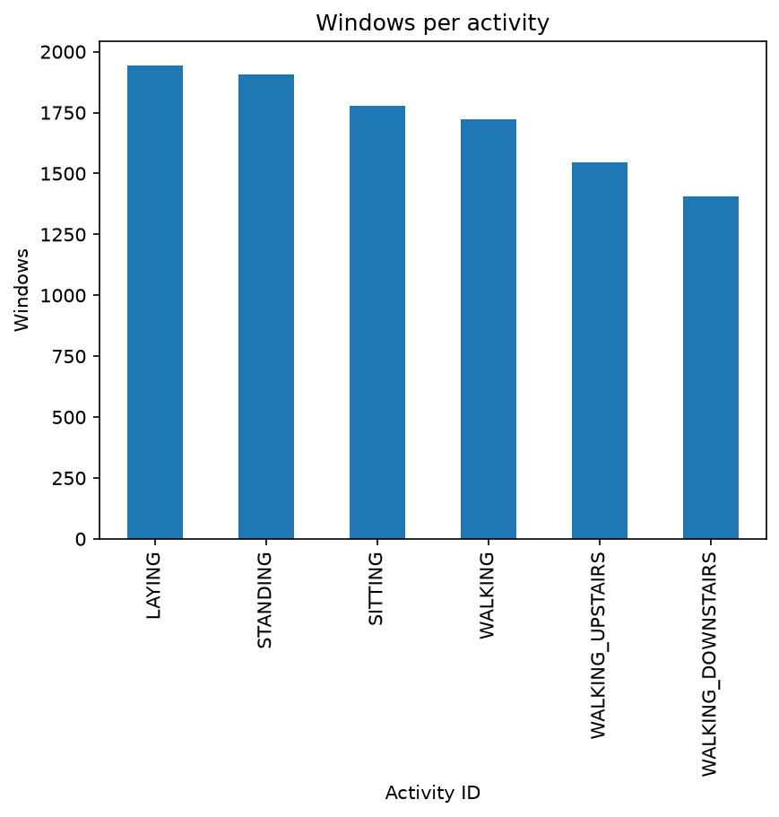
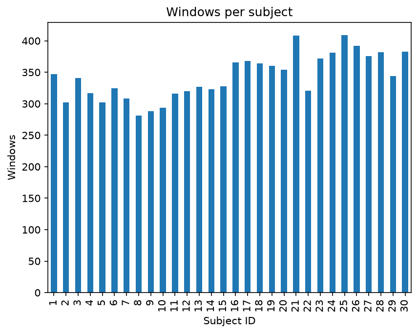
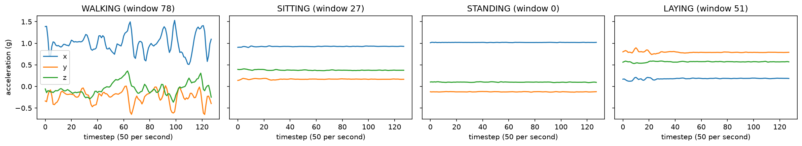

# Wearable Activity Recognition

Classifying human activity (walking, walking upstairs/downstairs, sitting, standing,
laying) from smartphone accelerometer and gyroscope signals, the same problem behind
activity tracking on wearables.

The focus is honest evaluation: models are scored on **people they have never seen**,
because that is what a real product faces.

> Status: in progress. Results, figures, and the product recommendation will be added here.

## Data

[UCI Human Activity Recognition Using Smartphones](https://archive.ics.uci.edu/dataset/240/human+activity+recognition+using+smartphones):
30 volunteers, 6 activities, 50 Hz signals cut into 2.56 s windows (128 samples, 50% overlap).

**Setup:** download the dataset zip from the link above and unzip it so this folder exists:

```
data/UCI HAR Dataset/
```

`data/` is git-ignored. If the folder is missing, the loader tries to download it automatically.

 
## What the data looks like




- **Classes are balanced:** each activity has roughly 1,400–1,950 windows, so accuracy won't be badly misleading.
- **People are balanced:** every subject contributes 280+ windows, so no single person dominates training.
- **Sitting vs standing is the hard pair:** both are static, so the signal is mostly gravity. They differ only in how gravity is split across the phone's axes, which reflects a small change in tilt.



## Usage

```bash
pip install -r requirements.txt
```

```python
from src.har.data import load

d = load()
d.features  # (10299, 561) engineered features per window
d.raw       # (10299, 9, 128) raw sensor channels per window
d.y         # activity labels 0-5 (names in d.activity_names)
d.subject   # person ID 1-30, used to split train/test by person
d.split     # official "train" / "test" assignment
```

## Plan

See [THEORY.md](THEORY.md) for the reasoning behind each step.

1. Majority-class baseline
2. Logistic regression and gradient boosting on engineered features
3. 1D convolutional neural network (PyTorch) on raw signals
4. Subject-grouped vs random cross-validation (measuring leakage)
5. Error analysis, per-person performance, learning curve, confidence thresholds
6. Product recommendation

## Results

A majority-class baseline scores about 19% accuracy under both splits. Any real model must clear this.
Logistic regression on the 561 engineered features reaches 0.985 macro-F1 with a random split but 0.957 when tested on unseen people. The random split nearly triples-understates the error rate, and hides a 4× larger variation between people. All results below use person-level splits.
## What I'd recommend the product team do

_Coming soon._
